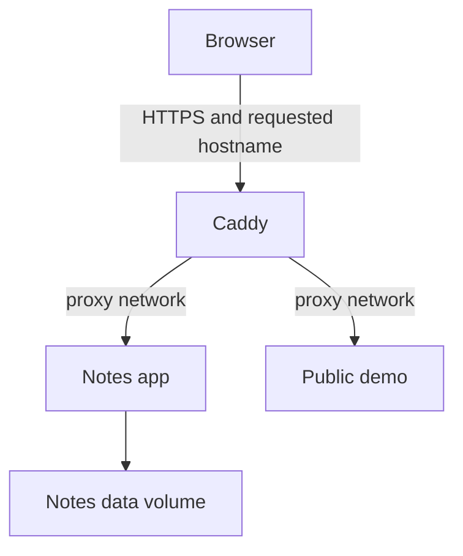

# Personal VPS workflow reference

**Docker Compose + Caddy | Ubuntu Server | Small personal projects**

Version 1.1 - 18 November 2026

This reference covers a fresh server, a first public test app, private apps,
local development, repeat deployments, maintenance, backups, recovery, and
adding services later. The companion bundle contains complete app examples,
Caddy templates, backup helpers, and a blank server inventory.

## 1. Choose the right procedure

| Situation | Follow |
| --- | --- |
| Brand-new VPS | Sections 3-7, then record the result in the inventory |
| Add another project | Section 8 |
| Deploy a code change | Sections 10-11 |
| Weekly or monthly upkeep | Section 12 |
| Back up or restore data | Sections 13-14 |
| Replace the entire VPS | Section 15 |
| Something is broken | Section 17 |
| Already using the original setup | Section 18 before adopting changed templates |
| Disable, resume, or remove a project | Section 20 |

**Execution labels matter.** LOCAL means your Windows computer or Android
development environment. VPS/root means the initial administrator session.
VPS/deploy means an SSH session as `deploy`, using `sudo` when shown.
Code blocks are examples to run at the stated stage, not one giant script.
Stop a procedure when a command fails and resolve the failure before moving on.

The concrete host examples use **Ubuntu Server 24.04 LTS**, systemd, ordinary
rootful Docker, an ext4 filesystem for the swap example, and SSH on port 22.
The same design also suits other supported Ubuntu releases, but check their
current package and SSH behavior. Debian needs Docker's Debian repository,
not the Ubuntu repository shown here. [S2, S3]

| Placeholder | Meaning |
| --- | --- |
| `203.0.113.10` | Replace with your real public IPv4 address |
| `203-0-113-10` | That address with hyphens instead of dots |
| `deploy` | Your ordinary administrative login |
| `myvps` | The SSH alias created in section 3 |
| `YOUR_REPO_URL` | Your project's actual Git repository URL |
| `PASTE_THE_HASH_HERE` | A real Caddy password hash, never the password itself |

The example IP is reserved for documentation. It cannot be used to deploy
this setup. Never put a private key, real password, or token in this guide.

## 2. Directory layout and how the pieces connect

### Is /srv a good location?

**Yes.** `/srv/apps/<project>` is a sensible place for deployed project
checkouts and Compose files; `/srv/proxy` is a clear place for the shared
reverse proxy. The filesystem standard assigns `/srv` to locally administered
service data but does not prescribe a particular subdirectory scheme. This
layout is a practical convention, not a requirement imposed by Docker. [S1]

Keeping files under `/srv` does not publish them. Caddy or an app serves only
the content its configuration exposes. Keep working copies on your own
device in a normal projects folder, and deploy selected revisions to `/srv`.

| Location | Purpose | Ownership / persistence |
| --- | --- | --- |
| `/srv/apps/notes` | Deployed notes source, Dockerfile, Compose file | `deploy`; source in Git |
| `/srv/apps/public-demo` | Public read-only test app | `deploy`; source can be recreated |
| `/srv/proxy/docker-compose.yml` | Runs the one shared Caddy container | `deploy` |
| `/srv/proxy/config/Caddyfile` | Main Caddy configuration | `deploy` |
| `/srv/proxy/config/sites/*.caddy` | One file per public hostname, or a shared IP site | `deploy` |
| `/srv/admin` | Administration and backup helper scripts | `deploy`; backed up |
| `/srv/backups` | Local backup staging, not an off-server backup | `deploy`; mode 0700 |
| Docker-managed volumes | Database files and Caddy state | Managed through Docker |
| `/etc/ssh`, `/etc/docker`, `/etc/systemd/system` | Host-level configuration | `root` |

Do not recursively change ownership of all of `/srv`. Create or change only
the directories you own and use. Do not manually edit Docker's storage tree.
The Docker data root is reported by `docker info`; named volumes are not
automatically inside `/srv/apps`. [S4]

### Request routing



Public DNS resolves a hostname to the VPS IP. The browser still sends the
requested hostname; Caddy selects its site configuration and forwards the
request. On the shared Docker network, Compose service names identify the
upstream apps. `notes:8000` is independent of the public name. [S5, S6]

Every app attached to `proxy` can potentially contact other apps on that
network. Omitting `ports:` prevents normal host port publication; it does not
make Caddy the only process capable of reaching the app. Databases normally
belong on a separate project network. Caddy's `localhost` refers to the Caddy
container itself, so proxy to the app's service name and internal port. [S5, S6]

## 3. ONE TIME: prepare local SSH access

**LOCAL - Windows PowerShell or an OpenSSH-equipped terminal.**

Generate a dedicated key with a passphrase. Check whether this filename
already exists first; do not overwrite a key you still need.

```bash
ssh-keygen -t ed25519 -f ~/.ssh/personal_vps_ed25519 -C personal-vps
```

In PowerShell, the corresponding explicit path can be:

```powershell
ssh-keygen -t ed25519 -f "$env:USERPROFILE\.ssh\personal_vps_ed25519"
Get-Content "$env:USERPROFILE\.ssh\personal_vps_ed25519.pub"
```

On Linux, macOS, or Termux, display only the public key:

```bash
cat ~/.ssh/personal_vps_ed25519.pub
```

Connect using the provider's initial administrator method:

```bash
ssh root@203.0.113.10
```

Verify a new host's SSH fingerprint through the provider console when
available. Keep access to the provider's rescue/console feature.

**VPS/root - fresh machine.**

```bash
apt update
apt upgrade
apt install sudo openssh-server ca-certificates curl git rsync unzip \
    ufw fail2ban unattended-upgrades python3 python3-venv
adduser deploy
usermod -aG sudo deploy
install -d -m 700 -o deploy -g deploy /home/deploy/.ssh
nano /home/deploy/.ssh/authorized_keys
```

Paste the public key as one line. Then set ownership and permissions:

```bash
chown deploy:deploy /home/deploy/.ssh/authorized_keys
chmod 600 /home/deploy/.ssh/authorized_keys
```

**LOCAL - a second terminal, while keeping the first session open.**

```bash
ssh -i ~/.ssh/personal_vps_ed25519 deploy@203.0.113.10
```

Run `sudo whoami` in that new session and confirm `root` is printed. Only
after this works should you restrict SSH authentication in section 4.

Add an alias to your LOCAL `~/.ssh/config` (on Windows, under your user
profile's `.ssh` folder):

```sshconfig
Host myvps
    HostName 203.0.113.10
    User deploy
    IdentityFile ~/.ssh/personal_vps_ed25519
    IdentitiesOnly yes
```

After replacing the IP, `ssh myvps` and `scp ... myvps:...` use the same key.
Each additional device can have its own key, added to `authorized_keys`.
Remove a lost device's public key without disturbing the others.

## 4. ONE TIME: secure and prepare the host

### SSH configuration

**VPS/deploy.** Keep the working session open during this procedure.

```bash
sudo tee /etc/ssh/sshd_config.d/00-personal-vps.conf > /dev/null <<'EOF'
PermitRootLogin no
PubkeyAuthentication yes
PasswordAuthentication no
KbdInteractiveAuthentication no
EOF
sudo sshd -t
sudo sshd -T | grep -E \
    'permitrootlogin|pubkeyauthentication|passwordauthentication|kbdinteractiveauthentication'
```

Expect `no`, `yes`, `no`, `no`, respectively. Ubuntu normally includes these
snippet files early, and most SSH directives use the first applicable value.
The filename alone is not proof that the intended settings won: inspect the
effective configuration, including any provider-specific `Match` rules. [S3]

If validation succeeds:

```bash
sudo systemctl reload ssh
```

Test `ssh myvps` again in a new local terminal. Do not close the original
session until that test succeeds. If you changed the SSH port, adapt all
firewall rules and client commands; this reference keeps port 22.

### Firewall and host updates

```bash
sudo ufw default deny incoming
sudo ufw default allow outgoing
sudo ufw allow 22/tcp
sudo ufw allow 80/tcp
sudo ufw allow 443/tcp
sudo ufw allow 443/udp
sudo ufw enable
sudo ufw status verbose
sudo dpkg-reconfigure -plow unattended-upgrades
sudo tee /etc/fail2ban/jail.d/sshd.local > /dev/null <<'EOF'
[sshd]
enabled = true
backend = systemd
EOF
sudo systemctl enable --now fail2ban
sudo fail2ban-client status sshd
```

Enable automatic Ubuntu security updates when prompted. The provider's
firewall must also allow the required ports. Port 443/UDP enables HTTP/3;
ordinary HTTPS works over 443/TCP. Keep IPv6 rules in mind if you enable IPv6.

**Docker-published ports can bypass UFW rules.** This design therefore
publishes only Caddy's 80/443 ports. Do not add public mappings for databases,
app port 8000, Docker's socket/API, or an editor merely because UFW is enabled.
Leave Docker's networking/firewall integration enabled. [S7]

Fail2ban and SSH key authentication do not automatically rate-limit web
application logins. Ubuntu's unattended upgrades do not rebuild container
images or update Python libraries baked into them. [S8]

### Memory and swap on a 2 GB VPS

```bash
free -h
swapon --show
df -h /
findmnt -no FSTYPE /
```

For a lightly loaded 2 GB VPS, a 2 GB swap file can absorb occasional build
spikes. Swap is slower than RAM and does not make an oversized workload fast.
Use this example only on a suitable filesystem such as ext4, with enough
free disk space. Investigate existing swap first; do not recreate a live file.

```bash
if [ ! -e /swapfile ]; then
    sudo fallocate -l 2G /swapfile
    sudo chmod 600 /swapfile
    sudo mkswap /swapfile
    sudo swapon /swapfile
    printf '/swapfile none swap sw 0 0\n' | sudo tee -a /etc/fstab
fi
swapon --show
```

## 5. ONE TIME: install Docker and create the layout

### Docker Engine and Compose plugin

**VPS/deploy - fresh Ubuntu system.** These commands use Docker's package
repository. If Docker is already working, inspect its installation first;
do not remove or reinstall a live Docker stack just to follow this section.
Check Docker's current installation documentation for supported releases and
conflicting distribution packages. [S2]

```bash
sudo install -m 0755 -d /etc/apt/keyrings
sudo curl -fsSL https://download.docker.com/linux/ubuntu/gpg \
    -o /etc/apt/keyrings/docker.asc
sudo chmod a+r /etc/apt/keyrings/docker.asc
. /etc/os-release
docker_codename="${UBUNTU_CODENAME:-$VERSION_CODENAME}"
docker_arch="$(dpkg --print-architecture)"
sudo tee /etc/apt/sources.list.d/docker.sources > /dev/null <<EOF
Types: deb
URIs: https://download.docker.com/linux/ubuntu
Suites: $docker_codename
Components: stable
Architectures: $docker_arch
Signed-By: /etc/apt/keyrings/docker.asc
EOF
sudo apt update
sudo apt install docker-ce docker-ce-cli containerd.io \
    docker-buildx-plugin docker-compose-plugin
sudo systemctl enable --now docker
sudo usermod -aG docker deploy
```

Log out and reconnect, then verify:

```bash
docker version
docker compose version
docker run --rm hello-world
```

Membership in `docker` grants root-level control of the host. Give it only
to trusted administrators; running a container as a non-root user does not
remove that privilege from the Docker administrator. [S9]

### Bound container log growth

On a fresh server with no existing daemon configuration:

```bash
sudo tee /etc/docker/daemon.json > /dev/null <<'EOF'
{
  "log-driver": "json-file",
  "log-opts": {"max-size": "10m", "max-file": "3"}
}
EOF
sudo dockerd --validate --config-file=/etc/docker/daemon.json
sudo systemctl restart docker
```

If this file already exists, merge these settings rather than overwriting
other configuration. A Docker restart can interrupt apps. New logging
defaults affect newly created containers; existing ones need recreation.
The supplied Compose files also set rotation explicitly. [S10]

### Create only the directories you need

```bash
sudo install -d -o deploy -g deploy -m 0755 \
    /srv/apps /srv/proxy /srv/admin
sudo install -d -o deploy -g deploy -m 0700 /srv/backups
docker network create proxy
```

Create the network once. On an existing server, use `docker network inspect
proxy` to check it instead. An external network is an already-created Docker
network shared across Compose projects; "external" does not mean public internet.

## 6. ONE TIME: prepare the shared Caddy proxy

**LOCAL - from the extracted bundle's root directory.**

```bash
scp -r templates/proxy myvps:/srv/
scp -r admin myvps:/srv/
```

The target directories were created above. Do not copy this template over an
existing proxy; use section 18 for migration.

**VPS/deploy.**

```bash
chmod 750 /srv/admin/*.sh /srv/admin/*.py
cd /srv/proxy
docker compose config --quiet
```

The proxy Compose file defines `name: proxy`, one `caddy:2` container,
80/443 port mappings, the external `proxy` network, and these mounts:

```yaml
volumes:
  - ./config:/etc/caddy:ro
  - caddy_data:/data
  - caddy_config:/config
```

The main file is `/srv/proxy/config/Caddyfile`:

```caddyfile
import /etc/caddy/sites/*.caddy
```

The whole config directory is mounted read-only. It contains the main file
and the `sites` directory, which avoids stale single-file mounts when an
editor saves by replacing a file. Caddy's persistent volumes retain its
certificates, keys, and state across recreation. [S6]

For a fresh setup, prepare these files now and start Caddy after you add
the first site in section 7. Use one shared proxy for all projects; do not
try to start several independent containers binding the same 80/443 ports.

## 7. FIRST PROJECT: public read-only deployment test

The bundled `templates/public-demo` is a complete FastAPI project with a
page, API, search, topic filters, and six fixed sample entries. It has no
database or login and rejects write methods with HTTP 405.

**LOCAL.**

```bash
scp -r templates/public-demo myvps:/srv/apps/
```

**VPS/deploy.**

```bash
cd /srv/apps/public-demo
docker compose config --quiet
docker compose up -d --build --wait --wait-timeout 120
docker compose exec -T publicdemo python -c \
    "import urllib.request as u; print(u.urlopen('http://127.0.0.1:8000/api/health').read())"
```

Expect a healthy container and a JSON response with `status: ok`. If `--wait`
fails, inspect `docker compose ps` and logs; it does not automatically undo
the deployment. [S11]

Copy the PUBLIC site template to the new canonical config directory:

```bash
nano /srv/proxy/config/sites/public-demo.caddy
```

The site file should contain:

```caddyfile
demo.203-0-113-10.sslip.io {
    reverse_proxy publicdemo:8000
}
```

Replace the dashed IP. There is deliberately no `basic_auth` here. Use
`templates/caddy/public-demo.caddy.example` as the copyable source if you
prefer; copy it from the local bundle, not from an imaginary server path.

For the FIRST proxy start, validate with a one-off container, then start it:

```bash
cd /srv/proxy
docker compose run --rm --no-deps caddy \
    caddy validate --config /etc/caddy/Caddyfile --adapter caddyfile
docker compose up -d
docker compose logs --tail=100 -f caddy
```

Only start after validation succeeds. Once certificate issuance succeeds,
Ctrl+C stops following logs, not the detached container.

Open `https://demo.YOUR-DASHED-IP.sslip.io/` on a second device or in a private
window. Expect no password dialog, six entries, and a green API connection
status. Press "Check again" and verify that a fresh server time appears.

```bash
cd /srv/apps/public-demo
python3 scripts/check.py https://demo.YOUR-DASHED-IP.sslip.io/
```

The check script verifies public reads and 405 responses to POST/PUT/PATCH/
DELETE. This proves this particular app rejects writes; removing Caddy auth
from a writable app would not make that app read-only.

## 8. EACH NEW PROJECT: repeatable addition procedure

### Record the decisions before deployment

| Decision | Notes example |
| --- | --- |
| Host folder and Compose project name | `/srv/apps/notes`; `name: notes` |
| Unique service name on proxy network | `notes` |
| App's internal listening port | `8000` |
| Public hostname or URL prefix | `notes.YOUR-DASHED-IP.sslip.io` |
| Access policy | Private: Caddy basic authentication |
| Persistent storage | Volume `notes_notes_data`, mounted at `/data` |
| Container data owner | UID:GID `10001:10001` in the supplied template |
| Health check and backup | `/api/health`; `backup-notes.sh` |

Names such as `api` used by two different projects can become ambiguous on
the shared network. Give every app service attached to `proxy` a unique name.
Top-level `name:` keeps Compose project names stable if a folder is renamed.
Changing a project or volume name can make an app attach to a new empty volume.

### Deploy the complete private notes example

**LOCAL.** The notes template contains the backend, frontend, requirements,
Dockerfile, Compose file, and ignore files. It supports add/list/delete notes.

```bash
scp -r templates/notes myvps:/srv/apps/
```

**VPS/deploy.**

```bash
cd /srv/apps/notes
docker compose config --quiet
docker compose up -d --build --wait --wait-timeout 120
docker compose exec -T notes python -c \
    "import urllib.request as u; print(u.urlopen('http://127.0.0.1:8000/api/health').read())"
docker run --rm -it caddy:2 caddy hash-password
```

Use the interactive prompt to create a strong password hash. The password
does not need to appear in shell history. Put the hash in a new file:

`/srv/proxy/config/sites/notes.caddy`

```caddyfile
notes.203-0-113-10.sslip.io {
    basic_auth {
        me PASTE_THE_HASH_HERE
    }
    reverse_proxy notes:8000
}
```

Store the actual password in your password manager. A hash in a Caddy file
is not subject to Compose's dollar-sign substitution because the file is
mounted as a file, not embedded in Compose YAML.

```bash
/srv/admin/reload-caddy.sh
```

This helper validates Compose and Caddy before reloading. Do not restart the
proxy just to add a route. If validation or reload fails, fix or restore the
on-disk configuration; a future restart will read that file too. [S12]

Open the notes URL, authenticate, add a test note, and verify it persists
after `docker compose restart notes` from `/srv/apps/notes`. Also test a
recreation with `docker compose up -d --force-recreate --wait`, then reload
the page. Preserve the data volume during both tests.

Back up the database, copy the backup off the server, and record the new app
in `records/server-inventory.md`. Repeat this procedure for the next project.

## 9. Address choices, authentication, and URL prefixes

| Choice | Public example | Required setup |
| --- | --- | --- |
| sslip.io hostname | `demo.203-0-113-10.sslip.io` | Use your real dashed IP in the Caddy site |
| Your own domain | `demo.example.com` | DNS A record to your IPv4; matching Caddy site |
| Raw IP with paths | `https://203.0.113.10/demo/` | One IP site, prefix routes, IP certificate configuration |

The DNS service provides name resolution; browser traffic goes to the VPS.
An IP address itself does not have subdomains: `notes.203.0.113.10` is not
the equivalent of `notes.example.com`. Use a real DNS hostname or a path.
If publishing AAAA records, make sure IPv6 actually reaches Caddy as well.

### Public and private apps

Place `basic_auth` on private site blocks, including their API routes.
Public read-only apps can omit it. Caddy authentication supplies a shared
access barrier, not separate per-person app accounts or permissions.
Use the application's own authentication if you need those features.

Do not publish an alternate unprotected port for a private app. Hostnames
and certificate identifiers can appear in public certificate logs; an
unadvertised URL is not an access-control mechanism.

### Raw IP and shared paths

Current Caddy builds can request Let's Encrypt IP certificates using the
`shortlived` profile. These certificates last about six days and must keep
renewing automatically. Use a current `caddy:2` image and persistent Caddy
data. Ordinary local/self-signed IP certificates are not automatically
trusted by other devices. [S13, S14]

Add this global block at the TOP of the main Caddyfile, before the import:

```caddyfile
{
    default_sni 203.0.113.10
}

import /etc/caddy/sites/*.caddy
```

Replace the IP and merge into an existing global block if needed. In Docker,
the default TLS name helps select the public IP certificate for connections
that arrive without a hostname in their TLS handshake. [S14]

The complete example is `templates/caddy/ip-paths.caddy.example`. It defines
ONE IP site, its ACME `shortlived` issuer, private `/notes/*` routing, and
public `/demo/*` routing. Do not create a separate duplicate IP site per app.

```caddyfile
redir /demo /demo/ 308
handle_path /demo/* {
    reverse_proxy publicdemo:8000
}
```

`handle_path` removes `/demo` before forwarding. Relative frontend URLs in
the supplied examples preserve the public prefix. For notes at `/notes/`,
create a server-only `/srv/apps/notes/.env` containing:

```dotenv
ROOT_PATH=/notes
```

The supplied notes Compose file passes this to FastAPI so `/notes/docs`
requests the correct schema URL. Other apps may need their own base-path
setting; a proxy cannot rewrite all hard-coded URLs inside an application.
Keep the trailing slash and the redirect for paths such as `/notes/`.

## 10. LOCAL DEVELOPMENT: Windows or Android

### Keep development and deployment as separate working copies

Your local device contains the working Git checkout. The VPS contains the
revision you chose to deploy. Git stores source history; databases, uploads,
secrets, and backups need separate treatment.

On Android, code-server running on `localhost` through Termux or a Linux
environment uses the tablet's resources. Python, Git, and the editor can run
locally while the VPS runs the deployed containers. Keep a Termux Git
checkout in its private home, such as `~/projects/notes`, rather than shared
`/sdcard` storage. Some extensions and native Python dependencies need
additional setup on Android. The final Docker build stays on the VPS. [S15]

On Windows, use local VS Code and Python, or WSL if that fits your tooling.
Create and activate a project virtual environment. Example local notes run:

```bash
python3 -m venv .venv
source .venv/bin/activate
python -m pip install -r requirements.txt
DB_PATH=./notes.db python -m uvicorn app.main:app --reload
```

PowerShell equivalent after creating the environment:

```powershell
python -m venv .venv
.\.venv\Scripts\Activate.ps1
python -m pip install -r requirements.txt
$env:DB_PATH = "./notes.db"
python -m uvicorn app.main:app --reload
```

Open `http://127.0.0.1:8000/` on the development device. `--reload` is a
development option; deployed containers use one ordinary Uvicorn worker.
If a script activation policy blocks PowerShell, invoke `.venv\Scripts\python.exe`
directly instead of changing system-wide execution policy.

### Git workflow

For a new source repository, initialize Git, review the ignore files, and
commit the baseline. Connect it to your chosen Git host. Keep `.env`, database
files, keys, and backup archives out of both Git and the Docker build context.
Use the included `.gitignore` and `.dockerignore` as a starting point.

```bash
git status
git add app Dockerfile docker-compose.yml requirements.txt \
    .gitignore .dockerignore
git commit -m "Describe the change"
git push
```

On a NEW VPS checkout:

```bash
git clone YOUR_REPO_URL /srv/apps/notes
```

Do not clone on top of a populated folder. If you initially copied files,
back them up and migrate deliberately. For private repositories, give the
VPS a dedicated repository-scoped read-only deploy key or another narrowly
scoped credential. Do not copy your personal workstation's private key to
the VPS, and do not put access tokens in a Git remote URL.

If you prefer copying files, this LOCAL alternative works from Linux,
macOS, Termux with rsync, or WSL/Git Bash where rsync is installed:

```bash
rsync -av --exclude .git --exclude .venv --exclude .env \
    --exclude '*.db*' --exclude '*.sqlite*' --exclude backups \
    ./ myvps:/srv/apps/notes/
```

Run it from the intended project root. Without `--delete`, removed local
files remain on the server; review them manually or use Git for clean
revision tracking. Do not add `--delete` casually. Copying and pulling are
alternative transfer methods, not steps to mix without a clear source of truth.

## 11. EACH RELEASE: deploy, verify, and roll back

### Ordinary code deployment

**LOCAL:** run relevant checks, commit, push, and note the commit ID.
**VPS/deploy:** back up affected data before schema or data changes.

```bash
cd /srv/apps/notes
git status --short
git rev-parse HEAD
```

The working tree should be clean before pulling. Record the old commit and,
after the first image exists, retain its image for rollback:

```bash
docker image tag personal-notes:current personal-notes:previous
git pull --ff-only
docker compose config --quiet
docker compose up -d --build --wait --wait-timeout 120
docker compose ps
docker compose logs --tail=100 notes
```

The tag step applies to the supplied notes template's image name. For other
projects, record their actual image name/ID. On the first deployment, there
is no previous image to tag.

Check the public page and API, authenticate if private, and verify existing
data. Use a private window when testing public access. Updating app code
usually needs no Caddy change or reload. Changing `.env` or Compose settings
needs `compose up`; `compose restart` alone does not apply new configuration.

| What changed? | Required action |
| --- | --- |
| Source copied into the image | Rebuild and recreate the app |
| requirements.txt or Dockerfile | Rebuild; test dependency compatibility |
| Compose environment / mounts / limits | Recreate with `compose up` |
| Caddy route or access policy | Validate and reload Caddy |
| Bind-mounted static content | Often visible immediately; check caching |
| Database schema | Back up, run the app's migration, verify compatibility |

An app may be briefly unavailable during recreation. `--wait` reports
startup/health results; it does not provide automatic rollback or zero
downtime. A health check becoming unhealthy does not, by itself, trigger the
ordinary Docker restart policy. [S11, S16]

### Code rollback

For a quick rollback using the retained image, create
`/srv/apps/notes/compose.rollback.yml`:

```yaml
services:
  notes:
    image: personal-notes:previous
```

Then use both files and avoid rebuilding:

```bash
docker compose -f docker-compose.yml -f compose.rollback.yml \
    up -d --no-build --wait --wait-timeout 120
```

Verify the app. Before the next normal deployment, resolve the source revision
in Git and record why the rollback happened. A later command using only the
main Compose file selects `personal-notes:current` again.

Rolling back code does not undo database migrations or deleted data. Restore
a compatible database snapshot if the schema change requires it. Do not use
`git reset --hard`, volume deletion, or broad pruning as an improvised rollback.

### Caddy configuration rollback

Before editing a live site, copy it to a filename ending in `.bak`, which the
`*.caddy` import does not include. Restore that file if needed, then run
`/srv/admin/reload-caddy.sh`. A failed reload normally leaves the prior running
configuration active; still repair the invalid files on disk before a restart.

## 12. REGULAR MAINTENANCE

| When | Action | Evidence to keep |
| --- | --- | --- |
| After every deployment | Check health, logs, public behavior, and stored data | Commit/image and result |
| Daily when data changes | Verified database backup; off-server copy as required | Backup timestamp and destination |
| Weekly | Review space, RAM/swap, failed units, containers, backup timer | Any failures and their resolution |
| Monthly or planned update window | Host packages, container/base images, app dependencies | Previous version, backup, validation |
| Periodically and after backup changes | Restore drill into an isolated target | Restore date and result |
| Before major OS/database changes | Verified backup plus optional provider snapshot | Recovery method and rollback plan |

Adjust frequency to the amount of data you can tolerate losing. A timer that
runs daily still requires a working off-server copy if the VPS disk is lost.

### Weekly inspection commands - VPS/deploy

```bash
df -h
df -i
free -h
swapon --show
docker ps -a
docker stats --no-stream
docker system df
systemctl --failed
systemctl list-timers 'notes-backup*'
sudo journalctl -u notes-backup.service -n 50 --no-pager
```

Look for repeated restarts, unhealthy containers, full disks/inodes, and
sustained swap activity. Build one project at a time on a 2 GB machine.
Leave room for the OS, Docker, Caddy, apps, and build processes together.
A container's memory limit does not cap the memory used by a separate image
build. An OOM exit such as 137 needs log and memory investigation.

### Host updates

```bash
sudo apt update
apt list --upgradable
sudo apt upgrade
if [ -f /var/run/reboot-required ]; then
    cat /var/run/reboot-required
fi
```

Review the upgrade and expect possible service restarts. Plan any required
reboot, then reconnect and verify Docker, Caddy, apps, and the backup timer.
Do not treat unattended security updates as a substitute for these checks.

### Container and base-image updates

For Caddy, record its running image ID before updating:

```bash
cd /srv/proxy
docker inspect "$(docker compose ps -q caddy)" --format '{{.Image}}'
docker compose pull caddy
docker compose up -d caddy
docker compose logs --tail=100 caddy
```

For notes, after retaining the previous image and backing up data:

```bash
cd /srv/apps/notes
docker compose build --pull
docker compose up -d --wait --wait-timeout 120
```

`pull` obtains newer images; `up` replaces containers. `build --pull` refreshes
a Dockerfile's base image. Installed Python packages still follow your
requirements file; update and test those dependencies deliberately. Keep
database image updates within the chosen major version until you perform
that database's documented major-version upgrade procedure.

### Disk cleanup

Inspect `docker system df` first. Remove specifically identified old images
only after retaining a rollback image and confirming that data is backed up.
`docker image prune` removes dangling images; even these may be useful for a
rollback. Build-cache pruning trades disk space for slower future builds.
Avoid `docker system prune --volumes`, `docker volume prune`, and `compose
down -v` as routine cleanup. A volume being unattached does not mean its data
is disposable. Normal `compose down` leaves named volumes but does stop/remove
the project's containers and non-external networks. [S4]

## 13. BACKUPS: data, configuration, and off-server copies

### What must be recoverable

| Asset | Recovery source |
| --- | --- |
| App source, Dockerfile, Compose definition | Git and/or a source archive |
| Databases | Consistent database snapshots or database-native dumps |
| User uploads and other persistent volumes | A suitable volume/file backup |
| Server-only .env and credentials | Encrypted backup or password manager |
| Caddy configuration and state | Config backup plus `proxy_caddy_data` volume backup |
| Host setup and scheduled jobs | This guide, inventory, selected `/etc` config, admin scripts |

A live `tar` of a writable SQLite volume is not the default backup method
here. It can capture database and WAL files at inconsistent moments. Use
SQLite's online backup API, or stop ALL writers before making a filesystem
copy. The supplied helper uses the online API and integrity-checks the copy.
It opens the source read-only and does not create an empty missing database.
[S17, S18]

### Notes snapshot - VPS/deploy

The admin helpers were copied to `/srv/admin` in section 6. The notes app
must be running for this online procedure:

```bash
/srv/admin/backup-notes.sh
ls -lh /srv/backups/notes/
```

The helper runs `sqlite-snapshot.py` in the app container, streams the checked
snapshot to a temporary host file, then publishes a `.db` file and a SHA-256
sidecar. A failed command does not publish a partially written final snapshot.
The five-minute timeout can be adjusted for an unusually large database.
No automatic deletion or off-server upload is configured by this script.

Copy a completed snapshot to another machine. **LOCAL**, using the real
filename printed by the script:

```bash
mkdir -p backups/notes
scp myvps:/srv/backups/notes/notes-TIMESTAMP.db backups/notes/
scp myvps:/srv/backups/notes/notes-TIMESTAMP.db.sha256 backups/notes/
```

The checksum sidecar uses the backup's basename so it also works after a copy.
From the local `backups/notes` folder, run `sha256sum -c
notes-TIMESTAMP.db.sha256`. On Windows use `Get-FileHash -Algorithm SHA256`
and compare its value. Store private data and secrets in an encrypted location appropriate
to your devices. A checksum detects accidental corruption, not unauthorized
changes by someone able to replace both files.

### Optional daily timer

Install the supplied units after testing one manual backup. **LOCAL:**

```bash
scp systemd/notes-backup.service systemd/notes-backup.timer myvps:/tmp/
```

**VPS/deploy:**

```bash
sudo install -m 644 /tmp/notes-backup.service /etc/systemd/system/
sudo install -m 644 /tmp/notes-backup.timer /etc/systemd/system/
sudo systemctl daemon-reload
sudo systemctl start notes-backup.service
sudo systemctl enable --now notes-backup.timer
systemctl list-timers notes-backup.timer
sudo journalctl -u notes-backup.service -n 30 --no-pager
```

The example runs daily at **03:00 Africa/Cairo time**, plus up to five minutes
of delay, and catches a missed calendar run after downtime. This creates
local snapshots only. Check failures and establish an off-server copy and
retention policy separately; the example does not send alerts. [S19, S20]

### Proxy and configuration backup

Back up `/srv/proxy`, `/srv/admin`, your per-app Compose files and server-only
environment files. These may contain hashes or secrets, so keep backup
directories private. Preserve the proxy's Docker project name, which makes
its default state volume `proxy_caddy_data`.

For a simple consistent Caddy-state archive, use a planned brief proxy stop.
Confirm the volume name with `docker volume ls` and download the helper image
BEFORE the interruption:

```bash
docker pull alpine:3
mkdir -p /srv/backups/proxy
chmod 700 /srv/backups/proxy
proxy_backup_name="caddy-data-$(date -u +%Y%m%dT%H%M%SZ).tgz"
cd /srv/proxy
docker compose stop caddy
proxy_backup_ok=0
if docker run --rm \
    --mount type=volume,src=proxy_caddy_data,dst=/source,readonly \
    --mount type=bind,src=/srv/backups/proxy,dst=/backup \
    alpine:3 sh -c 'umask 077; tar czf "$1" -C /source .' \
    sh "/backup/$proxy_backup_name"; then
    proxy_backup_ok=1
fi
docker compose start caddy
test "$proxy_backup_ok" -eq 1
```

This attempts to start Caddy again even when the archive command fails; the
final test succeeds only if the archive was created successfully. Verify the
proxy is running afterwards. Each archive has a timestamped name. The archive
is owned by root; use `sudo chown deploy:deploy` on that specific archive if
needed for copying. Take a separate timestamped archive of the
host config directory. The config volume can also be preserved if your
Caddy usage relies on persisted API-managed configuration.

## 14. RESTORE: notes database and verification

Practice on a disposable volume or spare server first. Restoring replaces
the target database; every process that writes that database must be stopped.
For an existing working app, take a new recovery snapshot with
`backup-notes.sh` first and retain it off-server. A restore is not a Git pull.

Place the selected verified snapshot at `/srv/backups/notes/restore.db`,
keeping its permissions private. Download the helper image before stopping
the app so a network download does not extend downtime:

```bash
docker pull python:3.12-slim
cd /srv/apps/notes
docker compose stop notes
docker ps --filter volume=notes_notes_data
```

There must be no running container using that volume. If another writer is
listed, stop it before continuing. Do not remove the volume.

```bash
docker run --rm --user 0:0 \
    --mount type=volume,src=notes_notes_data,dst=/data \
    --mount type=bind,src=/srv/backups/notes/restore.db,dst=/backup.db,readonly \
    --mount type=bind,src=/srv/admin/restore-sqlite.py,dst=/restore.py,readonly \
    python:3.12-slim python /restore.py /backup.db /data --owner 10001:10001
```

The helper checks SQLite integrity and the expected notes table before
changing the target. It then replaces `notes.db` and removes old WAL/SHM
sidecars. Its owner setting matches the supplied notes template; inspect
the actual container UID if restoring an older or different app. Never
remove live WAL files while writers are running.

Only after successful restore:

```bash
docker compose up -d --wait --wait-timeout 120
docker compose logs --tail=100 notes
```

Verify health, authentication, the expected notes and timestamps, and one
new write. Then restart once and verify persistence. If the restore command
fails, leave writers stopped until the cause is resolved; do not automatically
restart an app against an uncertain database.

## 15. REPLACEMENT VPS: rebuild and recover

1. Recover your inventory, source repositories, secrets, and off-server
   backups. Confirm the backups are readable before changing the old server.
2. Repeat the one-time host, Docker, directory, and proxy preparation steps.
   Recreate the external `proxy` network.
3. Restore source checkouts and Compose files with the SAME project/volume
   names. Restore server-only environment values and admin scripts.
4. Build the notes image and create its container/volume WITHOUT starting
   the application:

   ```bash
   cd /srv/apps/notes
   docker compose create --build notes
   ```

5. Restore the database using section 14, then start and verify the app.
   Restore other databases/uploads through their matching recovery procedures.
6. Restore the Caddy config directory. If preserving Caddy state, create the
   named volume and extract its archive while Caddy is STOPPED:

   ```bash
   docker volume create proxy_caddy_data
   docker run --rm \
       --mount type=volume,src=proxy_caddy_data,dst=/target \
       --mount type=bind,src=/srv/backups/proxy,dst=/backup,readonly \
       alpine:3 tar xzf /backup/caddy-data-TIMESTAMP.tgz -C /target
   ```

   Replace `TIMESTAMP` with the actual backup filename component.

7. Adjust public DNS or the embedded-IP hostnames to the new IP. A raw-IP
   setup also needs the new IP in its site and `default_sni`. Certificates
   for an old IP do not identify a new one; Caddy must obtain the new cert.
8. Validate Caddy, start it, and test public and private routes externally.
   DNS validation may need the new address to be reachable first.
9. Reinstall/test the backup timer and make a new off-server backup. Record
   the new host fingerprint, versions, IPs, and restore result.
10. Keep the previous server or snapshot until recovery is confirmed. Avoid
    allowing two servers to accept independent writes to diverging databases.

## 16. VARIATIONS: static sites, workers, and separate databases

### Static website

The complete `templates/static-site` uses `nginx:stable-alpine`, service
`statusweb`, internal port 80, and a read-only bind mount for `site/`. Copy
it to `/srv/apps/status`, start it, and route a public hostname with
`reverse_proxy statusweb:80`. It follows the same shared-proxy procedure.
Bind-mounted content changes do not require an image rebuild.

### Worker or bot

A worker with no incoming web interface normally needs no Caddy site and no
membership in the shared `proxy` network. Give it only the network access,
credentials, storage, and restart behavior its job needs. A worker still
needs logs, version tracking, and backups if it produces persistent data.

### PostgreSQL or another database service

Put the app on `proxy` plus a project-local database network. Put the database
only on that project-local network and omit `ports:` from the database.
For example, an app may use a `db` hostname on its own network without
colliding with another project's separate private `db` service.

Use a required environment value such as `${DB_PASSWORD:?Set DB_PASSWORD}`
in Compose and protect `.env` with mode 600. Compose interpolation and passing
an environment variable into a container are different operations: explicitly
configure which values the service receives. Avoid printing rendered config
containing secrets; use `docker compose config --quiet` for routine checks.

Use the database's own dump/restore tools and documented image mount path.
Do not reuse the SQLite backup helper or assume every PostgreSQL major
version has the same volume layout. Major database upgrades require an
explicit migration; changing a tag is not a migration procedure.

## 17. TROUBLESHOOTING: work from the outside inward

| Symptom | First checks | Likely next action |
| --- | --- | --- |
| SSH no longer connects | Provider console, IP, SSH port, firewall, sshd status | Repair SSH/firewall through console; keep working sessions open |
| Hostname does not resolve | Correct IP in name; A/AAAA records; `nslookup` | Fix DNS or hostname; wait for cached records to expire |
| Connection refused / timeout | Provider firewall, UFW, Caddy container, published ports | Restore reachability before changing the app |
| HTTPS/certificate error | Requested name/IP, ports 80/443, Caddy logs, server clock | Correct the actual error; avoid repeated blind issuance attempts |
| 401 on a public demo | Correct hostname/path; imported Caddy auth rules | Remove auth only from the intended public route |
| 502 Bad Gateway | Upstream service name/port; shared network; app health | Fix app startup, network membership, or upstream address |
| Page loads but API fails | Browser Network tab; API response; public path prefix | Fix API or frontend base-path configuration |
| Database is empty after redeploy | Actual volume mounts and Compose project name | Reattach the existing volume before creating more data |
| SQLite permission denied | Container UID:GID versus data owner | Correct only the stopped app's data-volume ownership |
| Container restarts / exits 137 | Logs, memory/swap, `docker inspect`, kernel OOM log | Reduce workload or memory usage; size the VPS accordingly |
| Changed Caddyfile seems ignored | Correct mounted directory and container-visible file | Validate actual mounted file; recreate old single-file mounts if necessary |
| Disk is full | `df -h`, `df -i`, Docker usage, log rotation, backup accumulation | Free identified disposable files; preserve data and rollback images |

Useful commands, choosing the affected project directory:

```bash
docker compose ps
docker compose logs --tail=100 notes
docker network inspect proxy
docker volume ls
docker inspect "$(docker compose ps -q notes)" --format '{{json .Mounts}}'
docker inspect "$(docker compose ps -q notes)" --format '{{json .State}}'
sudo journalctl -k --since '1 hour ago' --no-pager
```

For the proxy:

```bash
docker compose -f /srv/proxy/docker-compose.yml logs --tail=100 caddy
sudo ss -lntup
```

Use a hostname-aware test when DNS is in doubt but the destination is known:

```bash
curl --resolve demo.example.com:443:203.0.113.10 \
    https://demo.example.com/api/health
```

This keeps the hostname and TLS name while connecting to the selected IP.
The certificate must still match the hostname. Avoid `curl -k` as a normal
success test because it bypasses certificate verification. Do not share
logs or inspect output containing secrets without redacting them.

## 18. EXISTING SETUP: adopt improvements without losing data

### Proxy config directory migration - optional

The original layout used `/srv/proxy/Caddyfile`, `/srv/proxy/sites`, and two
separate mounts. It can keep working. This guide's `config/` layout mounts
the whole configuration tree, which makes future edits more predictable.
No app needs to move merely because the reference uses this layout.

During a planned proxy restart, copy rather than delete the original files:

```bash
mkdir -p /srv/proxy/config/sites
cp -a /srv/proxy/sites/. /srv/proxy/config/sites/
cp /srv/proxy/Caddyfile /srv/proxy/config/Caddyfile
```

Back up the old proxy Compose file. Replace only its two config bind mounts
with `./config:/etc/caddy:ro`, keeping the existing `caddy_data` and
`caddy_config` volumes, project name, ports, and network. Validate the NEW
mounts with `docker compose run --rm --no-deps caddy caddy validate ...`,
then recreate Caddy using `docker compose up -d caddy`. Verify all sites.
Keep the old files until that succeeds. Future site files go under
`/srv/proxy/config/sites`, not the old `/srv/proxy/sites` directory.

### Existing database volumes and container users

The original notes example usually created `notes_notes_data` when run from
the `notes` folder; verify actual mounts instead of assuming. The new template
keeps that default name by declaring `name: notes`. A different project name
or explicit volume name must be preserved deliberately.

The original Dockerfile did not fix a numeric UID. The supplied reference
template uses `10001:10001`. Before replacing an existing image, inspect its
actual user and data ownership. Keep the original UID in the new Dockerfile,
or back up, stop all writers, and change ownership only inside the intended
volume. Do not solve this by making the database world-writable or by
recursively changing unrelated host directories.

### Improvements relative to the starting workflow

- Host setup, per-project actions, and ongoing maintenance are separate.
- `/srv` ownership changes target only the intended folders.
- Docker is installed through its managed package repository.
- Caddy configuration is mounted as a directory and validated before reload.
- Public read-only apps and private writable apps have explicit access policies.
- Shared-network reachability and UFW's Docker limitation are stated accurately.
- SQLite backups use a consistent snapshot and have a matching restore path.
- Host, container, dependency, and database updates are treated separately.
- Existing volume names, container UIDs, and schema compatibility are preserved.

## 19. KEEP THE REFERENCE CURRENT

Use `records/server-inventory.md` to record the actual server and each project.
For every new service, record its source, deployed revision, service/port,
public route, access policy, environment values' storage location, data volume,
container UID, health check, backup, and restore procedure.

When adding a new workflow step or changing this setup:

1. State whether it runs once per server, once per project, per deployment,
   on a schedule, or only during recovery.
2. Record where to run it and which user runs it.
3. Name its inputs and prerequisites; keep secrets outside the document.
4. Write the expected result and a check that demonstrates it.
5. State what a failure changes and how to recover or revert it.
6. Update the example files, inventory, and change log together.

Do not maintain two conflicting "current" deployment procedures. Keep this
guide and non-secret templates under version control if you customize them.
Retain an off-server copy so the instructions survive loss of the VPS.

## 20. PROJECT LIFECYCLE: disable, resume, and remove

All commands in this section run on the VPS as `deploy`, unless stated
otherwise. They use the supplied notes project as the example. Substitute
the actual project, service, route, timer, and volume names for another app.
For the public demo there is no database volume or notes backup timer.

### Choose what you mean by disabling or removing

| Goal | Main action | What remains |
| --- | --- | --- |
| Disable public access only | Serve a maintenance response or remove the Caddy route | App and background jobs can still run |
| Temporarily stop the project | Disable its route/jobs, then `docker compose stop` | Containers, images, source, and volumes |
| Remove the deployed project, keep its data | Disable its route/jobs, then `docker compose down` | Named volumes, images, source/archive, and backups |
| Permanently delete its stored data | Remove its containers, inspect and explicitly delete its own volumes | Any separate backups or source archives you choose to retain |

`stop` is reversible; `down` removes the project's containers and its own
non-external networks. Normal `down` does not delete named volumes or the
shared external `proxy` network. Neither command removes the source folder
or Caddy site file. [S21, S22]

Before stopping a project, check whether another project uses its API,
database, files, or worker. Dependencies can exist across Compose projects.
Do not stop a shared database merely because one client app is being retired.

### Prepare: preserve the current configuration and data

For a project with a dedicated hostname, preserve its working Caddy file:

```bash
mkdir -p /srv/proxy/config/disabled
cp /srv/proxy/config/sites/notes.caddy \
    /srv/proxy/config/disabled/notes.caddy
```

If the project is already disabled, keep its saved working file; do not
overwrite it with the maintenance configuration by repeating this copy.

The `disabled` directory is outside the imported `sites/*.caddy` pattern.
For a shared raw-IP site, preserve the complete file as a backup but edit
only this project's path handlers. Do not replace or delete the entire shared
site, its TLS settings, or other projects' authentication.

For a predictable temporary outage, edit the ACTIVE notes site and replace
its `reverse_proxy` line with a 503 response, retaining the existing hostname
and authentication:

```caddyfile
notes.203-0-113-10.sslip.io {
    basic_auth {
        me KEEP_THE_EXISTING_HASH
    }
    respond "Temporarily offline for maintenance." 503
}
```

Use your real hostname and existing hash; the marker above is not a valid
hash. For a path-based app, place the response inside its existing handler
while retaining that handler's access controls. A public app keeps its
existing public policy. Validate and reload:

```bash
/srv/admin/reload-caddy.sh
```

Verify that the route no longer reaches the app. A private route should
still challenge unauthenticated requests and return 503 after authentication.
This controls public requests; the app can still be reached internally.

If you installed the notes timer, disable it before stopping the app:

```bash
sudo systemctl disable --now notes-backup.timer
```

Disabling a timer does not cancel an already-running backup service. Let
that run finish before continuing. Also suspend project-specific scheduled
workers, incoming jobs, and automated deployers that could restart the app.
For notes, take a final verified snapshot while its container is still running:

```bash
/srv/admin/backup-notes.sh
```

Copy the snapshot off-server using section 13. Record the deployed commit,
image, volume names, data owner, environment-file location, and Caddy file.
Back up other persistent data with its own procedure. Do not treat a source
archive as a database backup.

### Temporarily stop the project

After the preparation above:

```bash
cd /srv/apps/notes
docker compose stop
docker compose ps -a
```

This stops all services in this Compose project and releases their running
process resources. Containers and data remain. The supplied
`restart: unless-stopped` policy keeps manually stopped containers stopped
after a Docker/host restart. Other restart policies or external automation
can behave differently. [S16, S21]

The Caddy maintenance response avoids an accidental 502 while the app is
stopped. If you prefer removing public routing completely, move a dedicated
site file outside `sites/*.caddy` and reload instead. Depending on the rest
of the proxy configuration, an unconfigured hostname may give a TLS error
or another default response; a removed route does not promise a particular
HTTP status. Keep the original site file for re-enabling.

Record the project as disabled, including which timers/deployers were
suspended. Stopping the app alone does not disable those separate jobs.

### Re-enable the project

Start the retained deployment and check its health before restoring traffic:

```bash
cd /srv/apps/notes
docker compose up -d --no-build --wait --wait-timeout 120
docker compose logs --tail=100 notes
docker compose exec -T notes python -c \
    "import urllib.request as u; print(u.urlopen('http://127.0.0.1:8000/api/health').read())"
```

`--no-build` avoids an unintended rebuild. If the image has been removed,
recover or rebuild the intended version first. Preserve the original Compose
project/volume names and environment values so the existing data is attached.

For the dedicated hostname example, restore the saved Caddy site:

```bash
cp /srv/proxy/config/disabled/notes.caddy \
    /srv/proxy/config/sites/notes.caddy
/srv/admin/reload-caddy.sh
```

For a shared path site, restore only the affected path handler. Check the
public URL, authentication, and existing data. Then re-enable only the jobs
you previously suspended. For the optional notes timer:

```bash
sudo systemctl enable --now notes-backup.timer
sudo systemctl start notes-backup.service
```

Check the new backup and update the inventory to active. Keep the saved
site file until verification succeeds.

### Remove a deployment while retaining its data

First complete the preparation above: final backups, suspended jobs, and
preserved configuration. Then, in the project's own folder:

```bash
cd /srv/apps/notes
docker compose ps -a
docker volume inspect notes_notes_data
docker compose down
docker ps -a --filter label=com.docker.compose.project=notes
```

Confirm the volume name from actual mounts/inventory for other projects.
Inspect any remaining containers rather than removing unrelated resources.
Do not add `-v`, `--rmi`, or broad prune commands to this step. Named volumes
and images are retained by this ordinary removal. [S22]

Remove the ACTIVE Caddy file only if it belongs exclusively to this project:

```bash
rm -- /srv/proxy/config/sites/notes.caddy
/srv/admin/reload-caddy.sh
```

If that file was already moved out of the active configuration, skip its
removal rather than treating a missing file as a new failure.

For a shared raw-IP site, remove only the notes redirect/path handler instead
of deleting the shared file. Verify that the old route cannot reach the
retired app and that other sites continue to work.

If the project-specific backup units were installed, remove them after any
running backup has finished:

```bash
sudo systemctl disable --now notes-backup.timer
sudo rm -- /etc/systemd/system/notes-backup.timer \
    /etc/systemd/system/notes-backup.service
sudo systemctl daemon-reload
```

Archive source and server-only configuration in a private directory. In this
example, the saved Caddy file from preparation must still exist:

```bash
retired_dir="/srv/backups/retired/notes-$(date -u +%Y%m%dT%H%M%SZ)"
mkdir -p "$retired_dir"
chmod 700 /srv/backups/retired "$retired_dir"
cp /srv/proxy/config/disabled/notes.caddy "$retired_dir/"
cd /srv
mv /srv/apps/notes "$retired_dir/project"
rm -- /srv/proxy/config/disabled/notes.caddy
printf 'Retained project archive: %s\n' "$retired_dir"
```

This archive can contain `.env` secrets; keep it private and back it up
appropriately. Keep the separate database snapshot as well. A retained data
volume still uses disk space even though no app is running.

Remove or revoke project-only API tokens, repository deploy keys, webhooks,
and scheduled jobs when they are no longer needed. For your own domain,
remove the app's dedicated DNS record if it has no remaining use. You cannot
delete sslip.io's automatically resolving hostname; removing its Caddy route
prevents this server from serving the retired app under that name.

Record the project as retired and document where its data, source, and
configuration were retained. To bring it back later, restore the project
folder, matching names/credentials, route, and jobs; reissue revoked
credentials where necessary.

### Optional permanent data deletion

This is a separate decision from removing the deployment. Perform it only
when the selected data is meant to be discarded, and any backup you intend
to retain has been checked. For the exact notes volume in this template:

```bash
docker volume inspect notes_notes_data
docker ps -a --filter volume=notes_notes_data
```

Verify the volume's identity and that no containers reference it. Then the
explicit destructive command is:

```bash
docker volume rm notes_notes_data
```

Docker normally refuses a volume still in use. Do not force removal or use
volume pruning to bypass a mistaken selection. This deletes that volume's
database; it does not delete separate backup copies or project archives. [S23]

If you also choose to delete the source/config archive, use its exact recorded
path, replacing `TIMESTAMP`; do not use a wildcard or a broad parent directory:

```bash
rm -r -- /srv/backups/retired/notes-TIMESTAMP
```

Remove specifically identified project image tags only after checking they
are no longer needed by containers or for rollback. Keep or delete off-server
backups under your chosen retention policy, then update the inventory.

### Shared resources that belong to the remaining projects

| Keep for the other projects | Why |
| --- | --- |
| `/srv/proxy` and its running Caddy container | Other public/private routes use it |
| External Docker network `proxy` | Other projects communicate through it |
| `proxy_caddy_data` and `proxy_caddy_config` | Shared proxy certificates and state |
| Other apps' volumes, routes, credentials, and DNS | They have independent lifecycles |
| Generic admin helpers still used elsewhere | Removing one project does not retire shared tooling |

Finish by checking Caddy, one remaining app, relevant scheduled jobs, and
the inventory. Never run the proxy project's `compose down` or delete its
volumes as part of removing just the notes app.

## 21. SOURCES AND VALIDATION

The original supplied workflow is the basis for this handbook. The following
primary documentation was reviewed for the technical corrections and optional
features. Package commands and defaults can change; check current upstream
instructions when rebuilding substantially later.

| ID | Primary documentation |
| --- | --- |
| S1 | [Filesystem Hierarchy Standard: /srv](https://specifications.freedesktop.org/fhs/latest/srv.html) |
| S2 | [Docker Engine installation on Ubuntu](https://docs.docker.com/engine/install/ubuntu/) |
| S3 | [Ubuntu OpenSSH server](https://ubuntu.com/server/docs/how-to/security/openssh-server/) |
| S4 | [Docker volumes](https://docs.docker.com/engine/storage/volumes/) |
| S5 | [Docker Compose networking](https://docs.docker.com/compose/how-tos/networking/) |
| S6 | [Caddy: running with Docker Compose](https://caddyserver.com/docs/running#docker-compose) |
| S7 | [Docker and firewall rules](https://docs.docker.com/engine/network/packet-filtering-firewalls/) |
| S8 | [Ubuntu automatic updates](https://ubuntu.com/server/docs/how-to/software/automatic-updates/) |
| S9 | [Docker post-installation and group privileges](https://docs.docker.com/engine/install/linux-postinstall/) |
| S10 | [Docker logging configuration](https://docs.docker.com/engine/logging/configure/) |
| S11 | [Docker Compose up](https://docs.docker.com/reference/cli/docker/compose/up/) |
| S12 | [Caddy command-line validation and reload](https://caddyserver.com/docs/command-line) |
| S13 | [Let's Encrypt IP certificate availability](https://letsencrypt.org/2026/01/15/6day-and-ip-general-availability/) |
| S14 | [Caddy TLS configuration](https://caddyserver.com/docs/caddyfile/directives/tls) and [default_sni](https://caddyserver.com/docs/caddyfile/options#default-sni) |
| S15 | [code-server on Termux](https://coder.com/docs/code-server/termux) and [Android](https://coder.com/docs/code-server/android) |
| S16 | [Docker restart policies](https://docs.docker.com/engine/containers/start-containers-automatically/) |
| S17 | [SQLite online backup API](https://www.sqlite.org/backup.html) |
| S18 | [Python sqlite3 connection backup](https://docs.python.org/3/library/sqlite3.html#sqlite3.Connection.backup) |
| S19 | [systemd calendar time syntax](https://www.freedesktop.org/software/systemd/man/latest/systemd.time.html) |
| S20 | [systemd timers](https://www.freedesktop.org/software/systemd/man/latest/systemd.timer.html) |
| S21 | [Docker Compose stop](https://docs.docker.com/reference/cli/docker/compose/stop/) |
| S22 | [Docker Compose down](https://docs.docker.com/reference/cli/docker/compose/down/) |
| S23 | [Docker volume removal](https://docs.docker.com/reference/cli/docker/volume/rm/) |

The companion `VALIDATION.md` records the local checks actually run. The
reference does not imply that your real VPS, provider firewall, Docker daemon,
DNS, TLS issuance, or scheduled services have been configured or tested.
